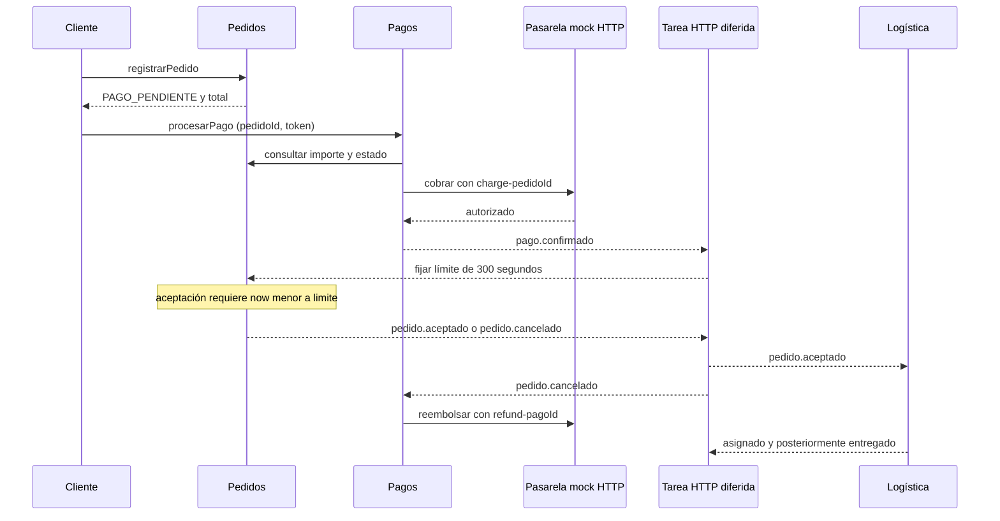

# Contratos implementados v1
La referencia completa de tipos, salidas, reglas, errores y calidad de las cuatro capacidades está en ../especificaciones/capacidades.md. Las identidades de actores son identificadores académicos, sin autenticación productiva.

| Servicio | Método y ruta | Operación |
|---|---|---|
| catálogo | GET /api/v1/restaurantes | consultarRestaurantes |
| catálogo | GET /api/v1/restaurantes/{id}/menu | consultarMenu |
| pedidos | POST /api/v1/pedidos | registrarPedido |
| pedidos | GET /api/v1/pedidos/{id} | consultarPedido |
| pedidos | POST /api/v1/pedidos/{id}/aceptacion | aceptarPedido |
| pedidos | POST /api/v1/pedidos/{id}/rechazo | rechazarPedido |
| pagos | POST /api/v1/pagos | procesarPago |
| pagos | GET /api/v1/pagos/pedido/{id} | consultar pago y reembolso |
| pagos | POST /api/v1/pagos/pedido/{id}/reintentar-reembolso | recuperar compensación en revisión |
| logística | POST /api/v1/asignaciones | asignarRepartidor |
| logística | GET /api/v1/asignaciones/{id} | consultar asignación y posición |
| logística | POST /api/v1/asignaciones/{id}/ubicaciones | actualizarUbicacion |
| logística | POST /api/v1/asignaciones/{id}/entrega | completarEntrega |
| facturación | GET /api/v1/facturas/{id} | consultar folio |
| facturación | POST /api/v1/facturas/{id}/reintentar | recuperar factura en revisión |
| calificaciones | POST /api/v1/calificaciones | registrarCalificacion |
| calificaciones | GET /api/v1/calificaciones/{id} | consultarCalificacion |

## Idempotencia y errores
Idempotency-Key es obligatorio en registrarPedido y procesarPago. Pedidos compara DTO serializado y pagos compara SHA-256 de pedido y token; mismo cuerpo y clave retornan el mismo identificador, cuyo estado puede haber evolucionado. Otro cuerpo produce 409 IDEMPOTENCY_CONFLICT. Asignación, entrega y opinión usan pedidoId como clave de negocio; posición usa sequence con comparación del cuerpo. No todos los POST requieren Idempotency-Key.

Importes BigDecimal, moneda fija MXN, timestamps ISO-8601 UTC. IDs son strings; pedido/pago/evento generan UUID y catálogo usa int64. No se guarda PAN, CVV ni token de tarjeta. Los errores locales usan application/problem+json con status, detail, code y correlationId. La proyección remota ausente puede devolver 409/404 mientras llega un evento: el cliente reconsulta con espera acotada. Las lecturas HTTP fallidas en dependencias se traducen a 503 DEPENDENCIA_NO_DISPONIBLE. Objetivos p95 están pendientes de pruebas de carga.

## Eventos de dominio
Notificaciones HTTP en segundo plano. Cada productor conserva una fila Outbox por suscriptor y realiza POST /interno/eventos en el servicio destinatario. Respuesta 204 después de aplicar el efecto e Inbox en la transacción del receptor. Sobre: eventId string UUID, eventType string, version integer=1, occurredAt instant UTC, aggregateId string, payload object. Esquema: evento.schema.json. Los receptores aceptan exclusivamente los tipos asignados a su servicio. Evento inválido: 400 EVENTO_INVALIDO. No hay orden global: estados monotónicos y claves de negocio protegen las transiciones.

| Tipo de evento | Publicador | Consumidores | Payload |
|---|---|---|---|
| pago.confirmado.v1 | pagos | pedidos | pedidoId, pagoId, importe decimal, moneda |
| pago.rechazado.v1 | pagos | pedidos | pedidoId, pagoId, importe decimal, moneda |
| pedido.aceptado.v1 | pedidos | logística | pedidoId, clienteId, restauranteId, latitud double, longitud double |
| pedido.cancelado.v1 | pedidos | pagos | pedidoId, pagoId, motivo |
| asignacion.pendiente.v1 | logística | pedidos | pedidoId, motivo |
| repartidor.asignado.v1 | logística | pedidos | pedidoId, repartidorId |
| pedido.entregado.v1 | logística | pedidos, facturación, calificaciones | pedidoId, clienteId, deliveredAt instant |

Cada publicación persiste una entrega por destinatario con el mismo eventId y distinto id de entrega. La publicación de pedido.entregado genera tres entregas independientes: pedidos, facturación y calificaciones. Es publicación-suscripción estática implementada por la aplicación.

Outbox se guarda junto a la transición de negocio. Una tarea cada segundo envía pendientes por HTTP y marca enviado al recibir 2xx. Si hay timeout después de aplicar el efecto, puede reenviar: Inbox por eventId y restricciones de negocio evitan duplicación. Una entrega fallida no bloquea los demás suscriptores. Reintentos de notificación con espera 2, 4, 8, 16, 32 y máximo 60 segundos; no hay descarte automático. Revisar las filas pendientes y los logs si persiste un error de contrato. Las filas ya enviadas no vuelven a enviarse por un fallo ajeno.

Reembolso y factura mantienen su política propia: tres intentos con espera 2/4 s y revisión; recuperar con sus endpoints conserva refund-{pagoId} e invoice-{pedidoId}. No se confunde reintento de transporte de un hecho con un nuevo cobro o factura. Los endpoints internos se ejecutan en red local de confianza; falta autenticación para un despliegue productivo.

## Justificación de cada interacción
- Cliente–catálogo y pedidos–catálogo: REST solicitud-respuesta síncrona porque la oferta y el precio son necesarios para continuar.
- Cliente–pedidos: registro y consulta síncronos; el cliente conoce identidad y estado, sin esperar toda la entrega.
- Cliente–pagos y pagos–pedidos: síncronos para validar importe autorizado por el propietario; el cliente no proporciona el total.
- Pagos–pasarela mock: HTTP síncrono; ante respuesta ambigua consultar por clave charge-{pedidoId} antes de volver a cobrar.
- Pagos–pedidos: eventos de pago porque confirmar el cobro y materializar la espera son transacciones independientes recuperables.
- Restaurante–pedidos: REST síncrono para saber si la decisión llegó antes del límite. Respuesta 409 si el endpoint materializa vencimiento al intentar aceptar tarde.
- Pedidos–logística: pedido.aceptado asíncrono; no bloquear la aceptación por falta temporal de repartidor.
- Pedidos–pagos: pedido.cancelado asíncrono; una caída de la pasarela no revierte la cancelación.
- Logística–pedidos: eventos de pendiente/asignado/entregado para reflejar hechos sin compartir tablas.
- Repartidor–logística: comandos REST confirmados de posición y entrega, con validación del identificador asignado.
- Logística–cliente: WebSocket asíncrono, notificación después del commit. GET de posición recupera el último dato tras desconexión.
- Logística–facturación y calificaciones: pub/sub de entrega; cada suscriptor avanza de manera independiente.
- Facturación–legado mock: HTTP síncrono dentro del trabajo para obtener NUM_FOLIO; no bloquea la entrega.
- Cliente–calificaciones: REST síncrono para saber si entrega y cliente permiten registrar opinión.

## Seguimiento
Conexión STOMP WebSocket: ws://localhost:8084/ws. Suscripción /topic/pedidos/{pedidoId}. Mensaje JSON: pedidoId, latitud, longitud, sequence, capturedAt y receivedAt. La vista /seguimiento.html facilita la demostración. No hay replay durable del stream; posición persistida vía REST. El WebSocket integrado de Spring difunde a conexiones de su proceso; se utiliza una instancia de logística.

