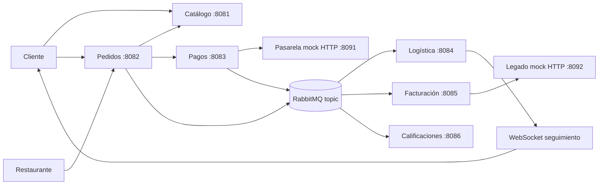

# Dominios y propiedad de datos
Estado: seis servicios implementados; evidencia y límites en reporte-final/resultados-pruebas.md.

| Dominio | Servicio / tipo | Datos exclusivos | Responsabilidad |
|---|---|---|---|
| Catálogo y restaurantes | catalogo / entidad | Restaurantes, productos, precios, disponibilidad, coordenadas del restaurante | Consultar oferta; no decide estados del pedido |
| Pedidos | pedidos / tarea | Pedido, partidas con precio capturado, dirección, estado, fechas, claves idempotentes | Coordinar compra y decisión del restaurante |
| Pagos y facturación | pagos / utilidad | Intentos, referencias de pasarela, reembolsos | Cobrar y reembolsar por HTTP |
| Pagos y facturación | facturacion / utilidad | Solicitudes, folios y referencias del legado | Traducir contrato al legado; no cobrar |
| Logística y seguimiento | logistica / entidad | Repartidores, disponibilidad, asignaciones y posiciones | Reservar repartidor, actualizar posición, confirmar entrega |
| Calificaciones | calificaciones / entidad | Puntuación, comentario, cliente y pedido | Registrar opinión de entrega confirmada |

Cada servicio posee una base MySQL y credencial independiente. No se permiten joins entre bases ni repositorios compartidos. Compose crea seis bases y seis usuarios con permisos exclusivos. preparar-entorno.ps1 genera sus contraseñas locales externas. El cliente y restaurante se representan mediante identificadores académicos; autenticación está pendiente y no debe anunciarse aptitud para producción.

Los adaptadores HTTP y las dos aplicaciones de simulación están implementados. El diagrama agrupado y etiquetado está en diagrama-dominios.mmd. Compose pendiente de ejecución local por ausencia de Docker.
