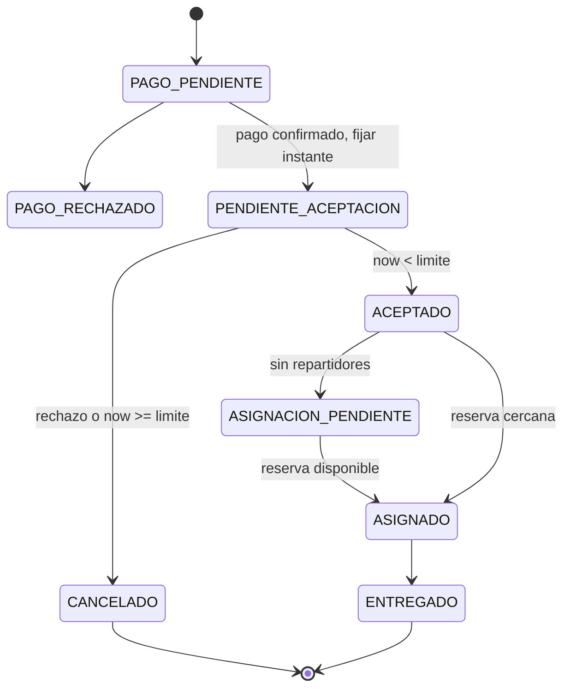

# Modelado del proceso Pedido de comida
Los cinco pasos siguientes son una propuesta de trabajo provisional. No se atribuyen al profesor: falta cotejarlos con la presentación completa de Unidad 2.

1. Descomponer el proceso: consultar oferta, seleccionar productos, registrar pedido, cobrar, esperar decisión, resolver rechazo o vencimiento, asignar, seguir, entregar, facturar y calificar.
2. Identificar candidatos: entidades Restaurante/Producto, Pedido, Repartidor y Calificación; tareas de coordinación y utilidades de integración.
3. Separar lógica agnóstica y específica: catálogo reutilizable; coordinación de compra específica; traducción de pasarela y legado encapsulada.
4. Delimitar contratos y composiciones: propietarios de datos, capacidades camelCase, REST inmediato y eventos de hechos consumados.
5. Refinar y validar: eliminar responsabilidades duplicadas; revisar todas las ramas, temporalidad, fallos y trazabilidad con pruebas. Pendiente validación de la denominación y orden oficiales.

| Actividad | Servicio | Tipo | Capacidad | Interacción / intercambio |
|---|---|---|---|---|
| Consultar restaurantes | catalogo | entidad | consultarRestaurantes | REST síncrona solicitud-respuesta |
| Consultar menú y precios | catalogo | entidad | consultarMenu | REST síncrona solicitud-respuesta |
| Registrar productos/cantidades | pedidos | tarea | registrarPedido | REST síncrona solicitud-respuesta |
| Obtener importes autorizados | catalogo | entidad | consultarMenu | REST síncrona solicitud-respuesta |
| Cobrar tarjeta tokenizada | pagos | utilidad | procesarPago | REST síncrona solicitud-respuesta; HTTP a mock |
| Notificar pago | pagos | utilidad | publicarPagoConfirmado | Asíncrona notificación pub/sub |
| Iniciar espera de aceptación | pedidos | tarea | confirmarPago | Consumidor asíncrono |
| Aceptar pedido | pedidos | tarea | aceptarPedido | REST síncrona solicitud-respuesta |
| Rechazar pedido | pedidos | tarea | rechazarPedido | REST síncrona solicitud-respuesta |
| Vencer plazo | pedidos | tarea | expirarPedido | Temporizador local persistido; publica notificación |
| Compensar cancelación | pagos | utilidad | reembolsarPago | Evento asíncrono + HTTP síncrona a mock |
| Asignar más cercano | logistica | entidad | asignarRepartidor | Evento asíncrono; resultado publicado |
| Reportar ausencia de repartidor | logistica | entidad | informarAsignacionPendiente | Notificación asíncrona a pedidos |
| Reintentar asignación | logistica | entidad | reintentarAsignacion | Trabajo diferido con reserva atómica |
| Reportar posición | logistica | entidad | actualizarUbicacion | REST síncrona solicitud-respuesta |
| Consultar seguimiento | logistica | entidad | suscribirSeguimiento | WebSocket asíncrono unidireccional servidor-cliente |
| Confirmar entrega | logistica | entidad | completarEntrega | REST síncrona + evento pub/sub |
| Generar comprobante | facturacion | utilidad | emitirFactura | Evento asíncrono + HTTP síncrona a legado mock |
| Calificar entrega | calificaciones | entidad | registrarCalificacion | REST síncrona solicitud-respuesta |

Regla temporal: limite = pendienteAceptacionAt + Duration.ofMinutes(5), en UTC con Clock inyectable. La condición de aceptar es estrictamente now < limite. El scheduler puede tardar en materializar CANCELADO, pero el endpoint rechaza desde el límite exacto. Aceptación y expiración deben competir por bloqueo/versión del mismo pedido. La espera empieza tras confirmar cobro, nunca al crear pedido. No aceptar eventos tardíos que revivan estados terminales.
