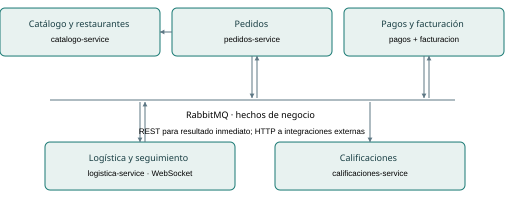
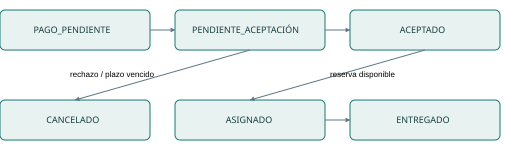

# 1. RapiEntrega: alcance y criterios de diseño

Arquitectura Orientada a Servicios · Unidad 2 · Reto 2 · Ingeniería en Sistemas Computacionales, séptimo semestre. Documento de diseño, 23 de octubre de 2026.

RapiEntrega conecta clientes, restaurantes y repartidores para consultar oferta, registrar pedidos, pagar, recibir una decisión del restaurante, coordinar entrega y calificar. El caso exige cancelar y reembolsar cuando no existe aceptación dentro de cinco minutos. Además, una pasarela externa conserva su propia API y la facturación depende de un sistema heredado de 2012 que no puede sustituirse. Estas restricciones motivan contratos independientes, una composición de proceso y adaptadores explícitos.

Se delimitan cinco dominios y seis servicios Spring Boot independientes: catálogo, pedidos, pagos, logística, facturación y calificaciones. Pagos y facturación pertenecen al mismo dominio financiero pero poseen datos y responsabilidades diferentes. El despliegue académico usa Java 21, Maven, MySQL, REST, Bean Validation, eventos HTTP diferidos y WebSocket. No se comparten tablas ni se realizan consultas SQL entre servicios.

La prioridad de corrección es impedir tres fallos: aceptar después del plazo, cobrar o reembolsar dos veces y reservar al mismo repartidor para dos entregas activas. Los estados persistidos, restricciones únicas, bloqueos y claves idempotentes cubren estos riesgos. La consistencia entre servicios es eventual; la recepción de un pago no obliga a bloquear la llamada del cliente hasta que todos los suscriptores terminen.

El repositorio incluye código para las ocho aplicaciones —seis servicios y dos simulaciones HTTP—, datos de ejemplo, colección Postman, scripts locales, pruebas y guía de demostración. El carácter simulado de pasarela y legado se declara en sus respuestas y documentación. No existe integración con tarjetas reales ni un sistema fiscal real.

La consigna fuente es Retos_Unidad_2_Diseno_de_servicios.pdf, páginas 10–17. Exige documento de 10–15 páginas, diagrama de dominios, implementación y debate. No fija esta pila tecnológica: se eligió por la solicitud del proyecto. La presentación completa de Unidad 2 no fue proporcionada; la denominación exacta de los cinco pasos, los patrones vistos y los encabezados de la plantilla requieren cotejo docente. Se documenta una propuesta verificable sin atribuirla al profesor.

La entrega puede evaluarse por trazabilidad: actividad → capacidad → servicio → interacción → método → prueba. Los resultados ejecutados y las limitaciones aparecen en el capítulo 12; el documento no presenta objetivos de calidad como mediciones realizadas.

<!-- pagebreak -->

# 2. Modelado orientado a servicios: cinco pasos

Los siguientes cinco pasos son una propuesta aplicada al caso; falta cotejar sus nombres y orden con la presentación completa. Cada paso produce un resultado concreto, en vez de limitarse a enumerar títulos.

1) Descomponer el proceso. Se identifican actividades de búsqueda de restaurantes, consulta de menú, selección de cantidades, registro, validación de precios, cobro externo, confirmación del pago, espera de aceptación, aceptación/rechazo, vencimiento, compensación, selección de repartidor, reporte de posición, entrega, emisión de comprobante y calificación. El flujo alterno incluye pago rechazado, proveedor indisponible y ausencia de repartidores. Resultado: inventario de actividades y máquina de estados del capítulo 7.

2) Proponer operaciones candidatas. Cada actividad se expresa con verbo y sustantivo camelCase: consultarRestaurantes, consultarMenu, registrarPedido, procesarPago, confirmarPago, aceptarPedido, rechazarPedido, expirarPedido, reembolsarPago, asignarRepartidor, actualizarUbicacion, completarEntrega, emitirFactura y registrarCalificacion. Se distingue una operación ofrecida por REST de una transición interna disparada por evento: confirmarPago pertenece al consumo del hecho de pago y no es un endpoint público para falsificar cobros. Resultado: capacidades candidatas vinculadas en la matriz.

3) Agrupar y clasificar candidatos. Catálogo concentra entidades restaurante/producto; logística posee repartidor/asignación/posición; calificaciones posee opinión y una proyección mínima de entrega. Pedidos es tarea: coordina una compra concreta y sus transiciones. Pagos y facturación son utilidades de integración, con reglas locales de transacción y folio. Resultado: seis servicios agrupados en cinco dominios y tipos explícitos, sin que catálogo decida aceptación ni logística calcule importes.

4) Definir contratos y composición. REST solicitud-respuesta cubre consultas y comandos que necesitan resultado inmediato. Una tarea de Spring entrega por HTTP los hechos persistidos a cada suscriptor de manera independiente. WebSocket comunica cambios de posición del servidor al cliente. Los contratos definen entradas con tipos, salidas, errores e idempotencia. Resultado: cuatro especificaciones completas, tabla de mensajes y secuencia. Pedidos controla la política de cinco minutos; pagos controla la compensación y no decide cuándo un pedido vence.

5) Refinar y validar. Se elimina la duplicación de precios, estados y reservas; se conserva una copia histórica del precio dentro del pedido y una proyección de entrega en calificaciones. Estas copias responden a contratos, no a acceso compartido a tablas. Se revisan límite temporal, carreras, evento duplicado, timeout ambiguo y recuperación. Resultado: pruebas de precio, límites, reembolso único, reserva concurrente y errores de integración, más una lista de límites de despliegue.

La separación distingue reutilización de proceso: consultarMenu puede reutilizarse en otros procesos sin conocer la compra; registrarPedido coordina necesidades específicas de este proceso. Un dominio no equivale necesariamente a una aplicación ni a una tabla: el dominio financiero contiene dos servicios especializados.

<!-- pagebreak -->

# 3. Matriz de mapeo de actividades y servicios

| Actividad | Servicio | Tipo | Capacidad | Interacción / intercambio |
|---|---|---|---|---|
| Consultar restaurantes | catalogo | entidad | consultarRestaurantes | REST síncrona solicitud-respuesta |
| Consultar menú y precios | catalogo | entidad | consultarMenu | REST síncrona solicitud-respuesta |
| Registrar productos/cantidades | pedidos | tarea | registrarPedido | REST síncrona solicitud-respuesta |
| Obtener importes autorizados | catalogo | entidad | consultarMenu | REST síncrona solicitud-respuesta |
| Cobrar tarjeta tokenizada | pagos | utilidad | procesarPago | REST síncrona solicitud-respuesta; HTTP a mock |
| Notificar pago | pagos | utilidad | publicarPagoConfirmado | Asíncrona notificación pub/sub |
| Iniciar espera de aceptación | pedidos | tarea | confirmarPago | Consumidor asíncrono |
| Aceptar pedido | pedidos | tarea | aceptarPedido | REST síncrona solicitud-respuesta |
| Rechazar pedido | pedidos | tarea | rechazarPedido | REST síncrona solicitud-respuesta |
| Vencer plazo | pedidos | tarea | expirarPedido | Temporizador local persistido; publica notificación |
| Compensar cancelación | pagos | utilidad | reembolsarPago | Evento asíncrono + HTTP síncrona a mock |
| Asignar más cercano | logistica | entidad | asignarRepartidor | Evento asíncrono; resultado publicado |
| Reportar ausencia de repartidor | logistica | entidad | informarAsignacionPendiente | Notificación asíncrona a pedidos |
| Reintentar asignación | logistica | entidad | reintentarAsignacion | Trabajo diferido con reserva atómica |
| Reportar posición | logistica | entidad | actualizarUbicacion | REST síncrona solicitud-respuesta |
| Consultar seguimiento | logistica | entidad | suscribirSeguimiento | WebSocket asíncrono unidireccional servidor-cliente |
| Confirmar entrega | logistica | entidad | completarEntrega | REST síncrona + evento pub/sub |
| Generar comprobante | facturacion | utilidad | emitirFactura | Evento asíncrono + HTTP síncrona a legado mock |
| Calificar entrega | calificaciones | entidad | registrarCalificacion | REST síncrona solicitud-respuesta |

La matriz cubre tanto el camino exitoso como rechazo, vencimiento, compensación y ausencia de repartidores. La clasificación entidad/tarea/utilidad organiza responsabilidades; no implica que cada actividad requiera un servicio nuevo. Los nombres de capacidades se corresponden con métodos de servicios o trabajos internos, según el canal.

El sistema conserva separación entre notificación de un hecho y ejecución de una acción externa: pedido.cancelado no constituye por sí mismo un reembolso finalizado; pagos registra el trabajo pendiente y lo confirma después de obtener respuesta de la pasarela. Asimismo, pedido.entregado habilita calificación y factura por suscripciones independientes.

<!-- pagebreak -->

# 4. Dominios, propietarios y diagrama

| Dominio | Servicio / tipo | Datos exclusivos | Responsabilidad |
|---|---|---|---|
| Catálogo y restaurantes | catalogo / entidad | Restaurantes, productos, precios, disponibilidad, coordenadas del restaurante | Consultar oferta; no decide estados del pedido |
| Pedidos | pedidos / tarea | Pedido, partidas con precio capturado, dirección, estado, fechas, claves idempotentes | Coordinar compra y decisión del restaurante |
| Pagos y facturación | pagos / utilidad | Intentos, referencias de pasarela, reembolsos | Cobrar y reembolsar por HTTP |
| Pagos y facturación | facturacion / utilidad | Solicitudes, folios y referencias del legado | Traducir contrato al legado; no cobrar |
| Logística y seguimiento | logistica / entidad | Repartidores, disponibilidad, asignaciones y posiciones | Reservar repartidor, actualizar posición, confirmar entrega |
| Calificaciones | calificaciones / entidad | Puntuación, comentario, cliente y pedido | Registrar opinión de entrega confirmada |

Cada aplicación tiene su propia base MySQL y usuario local con permisos exclusivos. Las bases se preparan con scripts/crear-bases.ps1 y cada proceso se inicia mediante scripts/iniciar-servicio.ps1. No se comparten tablas ni se hacen joins entre aplicaciones.

Las notificaciones se guardan como entregas en la tabla Outbox del productor. Una tarea invoca HTTP hacia los servicios suscritos y cada receptor confirma después de persistir su efecto e Inbox. La publicación-suscripción tiene destinatarios estáticos y no necesita un componente de infraestructura separado. La figura central representa este mecanismo lógico distribuido, no un servicio adicional.

REST sirve para consultas, pago y decisiones inmediatas. WebSocket difunde posiciones desde la instancia de logística. Los adaptadores externos usan HTTP hacia las dos aplicaciones de simulación. El diagrama Mermaid completo incluye las interacciones principales etiquetadas.

<!-- pagebreak -->

# 5. Patrones de diseño y problemas concretos

Los nombres siguientes figuran en el catálogo de SOA Design Patterns de Thomas Erl (2009), verificado en el índice oficial del autor. Falta comprobar su selección exacta contra lo visto en clase. Las descripciones son una aplicación propia al caso, no citas textuales del profesor ni del libro.

Entity Abstraction. Problema: varios participantes necesitan restaurantes y precios, pero replicar la administración de oferta produciría valores contradictorios. Aplicación: CatalogoService encapsula restaurante/producto y ofrece consultarRestaurantes y consultarMenu. Pedidos solo captura una fotografía del precio para preservar el importe histórico. Evidencia: repositorios exclusivos de catálogo y prueba de precio decimal. Coste: la creación de una compra depende de la disponibilidad de catálogo; se limita la espera HTTP y se devuelve error identificable.

Process Abstraction. Problema: una compra combina reglas de varias áreas y podría distribuir de manera contradictoria la aceptación, el cobro y el vencimiento. Aplicación: pedidos concentra estados y temporización del proceso, mientras solicita capacidades de servicios especializados. Evidencia: DominioService de pedidos fija pendienteAceptacionAt, calcula el límite y decide aceptar/rechazar/expirar. Pagos administra el cobro y su compensación sin gobernar la política de aceptación. Coste: el coordinador debe persistir su estado y gestionar concurrencia; no se ejecuta una transacción SQL distribuida.

Legacy Wrapper. Problema: no se puede reemplazar la facturación de 2012 ni propagar su formato a todos los equipos. Aplicación: facturacion-service recibe pedido.entregado y LegadoAdapter transforma pedidoId/clienteId a ID_ORDEN/ID_CLIENTE y obtiene NUM_FOLIO mediante HTTP simulado. Evidencia: adaptador, trabajo de factura persistido y prueba de fallo/reintento. Coste: latencia y dependencia del sistema legado; un estado REVISION y una operación de recuperación permiten resolver fallos persistentes. No se supone que el sistema real de 2012 tenga REST: el mock representa su frontera para la práctica.

Event-Driven Messaging. Problema: entrega interesa a varios servicios y no debe esperar a que facturación y calificaciones estén disponibles simultáneamente. Aplicación: una publicación crea una entrega persistida por servicio interesado; una tarea realiza HTTP en segundo plano. Evidencia: Eventos, OutboxPublisher, EventoController e Inbox. Coste: consistencia eventual, destinatarios estáticos y reintentos persistidos que deben inspeccionarse si el fallo continúa. La idempotencia de efectos es una propiedad de las reglas y restricciones locales; no se promete entrega exactly-once.

Estas decisiones resuelven problemas distintos: propiedad de entidades, composición del proceso, encapsulación del legado y comunicación de hechos. Outbox e inbox son mecanismos de fiabilidad complementarios; no se presentan como nombres verificados del catálogo de clase.

Fuente primaria: Thomas Erl, SOA Design Patterns, índice oficial: https://www.thomaserl.com/book/soa-design-patterns/table-of-contents/index.html (consulta 23-10-2026).

<!-- pagebreak -->

# 6. Comunicación, contratos y publicación-suscripción

REST solicitud-respuesta síncrona cubre catálogo, registro, pago, decisión del restaurante y comandos del repartidor porque requieren confirmar validación y estado. Los adaptadores de pasarela y legado usan HTTP con respuesta inmediata dentro de sus servicios propietarios.

| Tipo de evento | Publicador | Consumidores | Payload |
|---|---|---|---|
| pago.confirmado.v1 | pagos | pedidos | pedidoId, pagoId, importe decimal, moneda |
| pago.rechazado.v1 | pagos | pedidos | pedidoId, pagoId, importe decimal, moneda |
| pedido.aceptado.v1 | pedidos | logística | pedidoId, clienteId, restauranteId, latitud double, longitud double |
| pedido.cancelado.v1 | pedidos | pagos | pedidoId, pagoId, motivo |
| asignacion.pendiente.v1 | logística | pedidos | pedidoId, motivo |
| repartidor.asignado.v1 | logística | pedidos | pedidoId, repartidorId |
| pedido.entregado.v1 | logística | pedidos, facturación, calificaciones | pedidoId, clienteId, deliveredAt instant |

Para comunicar hechos, el productor guarda Outbox junto a su transacción de negocio y termina el comando sin esperar los suscriptores. Una tarea de Spring, cada segundo, realiza POST /interno/eventos a cada destinatario. El transporte HTTP individual es síncrono; el proceso de notificación es asíncrono respecto a la operación original. No se debe confundir esa distinción de niveles.

La publicación-suscripción es estática y explícita: pedido.entregado tiene tres destinatarios y tres filas de entrega, con un eventId común. Cada una se confirma por separado. Si facturación no responde, pedidos y calificaciones pueden avanzar y sus entregas confirmadas no se repiten por ese fallo. La dirección de cada servicio se externaliza mediante variables de entorno.

El receptor devuelve 204 tras persistir su efecto e Inbox. Una respuesta perdida puede provocar reenvío: Inbox por eventId y restricciones de negocio hacen idempotente el efecto. Las entregas fallidas permanecen en Outbox y se reintentan con espera exponencial 2/4/8/... hasta 60 segundos. No se descartan automáticamente. El operador consulta filas pendientes y logs ante fallos de contrato prolongados.

Sobre común: eventId UUID, eventType string, version integer=1, occurredAt instant UTC, aggregateId string y payload object. Cada receptor valida versión, campos básicos y tipos de evento pertinentes. Los estados terminales impiden retrocesos por hechos tardíos; no se promete orden global ni exactly-once de red.

WebSocket STOMP integrado de Spring notifica posiciones después del commit. La suscripción es /topic/pedidos/{pedidoId} en /ws; GET de asignación recupera la última posición al reconectar. Se utiliza una instancia de logística y no hay replay durable ni autenticación productiva. No se afirma escalabilidad horizontal del stream de esta implementación.

<!-- pagebreak -->

# 7. Estados, temporalidad y fallos distribuidos

Una compra inicia PAGO_PENDIENTE. Confirmar cobro crea PENDIENTE_ACEPTACION, fija pendienteAceptacionAt UTC y calcula limite = pendienteAceptacionAt + 300 segundos. Solo se acepta cuando now < limite. En igualdad ya está vencido: se devuelve conflicto, se conserva CANCELADO y se crea el evento de compensación en outbox. Un trabajo de un segundo materializa vencimientos sin depender de que el restaurante intente aceptar. El retardo del trabajo no prolonga la validez del pedido.

Aceptación, rechazo y expiración bloquean la misma fila. Una carrera no puede producir dos decisiones válidas desde la misma versión. Si se rechaza antes del plazo, se cancela por decisión del restaurante. Si se cumple el plazo, se cancela por vencimiento. Un segundo intento sobre estado terminal genera conflicto y no produce otra cancelación. Un pago rechazado no habilita aceptación ni inicia el temporizador.

Pagos recibe cancelación y marca un trabajo de reembolso. No mantiene la recepción del evento abierto durante todos los reintentos externos. El proveedor recibe refund-{pagoId}, clave que se conserva incluso si la respuesta se pierde después del efecto. Para cobro se usa charge-{pedidoId}; ante timeout se consulta estado antes de permitir repetir el mismo intento. Las restricciones de base y la idempotencia del proveedor tienen responsabilidades diferentes: la base sola no puede evitar un segundo efecto remoto después de una caída.

Logística recibe únicamente pedidos aceptados. Si no hay disponibilidad, conserva una asignación pendiente y reintenta cada diez segundos. La reserva bloquea candidatos, elige el mínimo Haversine y marca ocupado en una sola transacción. Completar entrega libera al repartidor y publica un único hecho de entrega. Los pedidos entregados no vuelven a asignados aunque llegue tarde un evento previo.

Política de notificación: cada entrega HTTP se reintenta en segundo plano con espera 2/4/8/... hasta un máximo de 60 segundos y se conserva pendiente hasta confirmar el efecto. Los trabajos de reembolso y factura realizan tres intentos con esperas de 2 y 4 segundos, después quedan en revisión y admiten recuperación REST con clave estable. HTTP usa timeout de conexión de 2 s y lectura de 3 s. Los errores de dependencia devuelven 503; conflictos de estado o concurrencia, 409. No se reintenta automáticamente una tarjeta rechazada.

Escalabilidad: las aplicaciones pueden desplegarse por separado; las réplicas compiten por filas de trabajo, manteniendo propiedad de datos. La selección de todos los candidatos y el barrido del outbox son adecuados para el volumen académico pero requieren paginación, índices y medición para volúmenes mayores. No se afirma capacidad de carga sin medirla. La versión académica usa Hibernate update; producción requiere migraciones versionadas y controles de acceso.

<!-- pagebreak -->

# 8. Especificación: registrarPedido

Servicio: pedidos-service; tipo tarea. Código: services/DominioService.registrarPedido; POST /api/v1/pedidos, 201.

Entradas: Idempotency-Key string no vacío de máximo 128; clienteId string no vacío; restauranteId int64 positivo; items array de 1..100 elementos {productoId int64 positivo, cantidad int32 de 1..99}; entrega {latitud double [-90,90], longitud double [-180,180], direccion string de 1..300}. El DTO se llama RegistrarPedido y aplica Bean Validation. No se admite precio enviado por el cliente como autoridad.

Salidas: Pedido con id string UUID, version int64, estado string PAGO_PENDIENTE, total BigDecimal con escala 2, clienteId string, restauranteId int64, dirección y coordenadas; partidas string JSON con productoId int64, cantidad int32 y precioUnitario decimal. Incluye clave y solicitud serializada para trazabilidad idempotente, sin información de tarjeta. pagoId, limite y pendienteAceptacionAt son nulos antes de confirmar el pago. La moneda de la solución académica es MXN.

Reglas: consultar menú y restaurante por REST; todos los productos deben estar disponibles y pertenecer al mismo restaurante. Rechazar productos duplicados en vez de sumarlos implícitamente. Calcular suma de precio*cantidad mediante BigDecimal; máximo total 9999999999.99. Capturar precios históricos en las partidas. Misma clave y mismo DTO retornan el mismo pedido; misma clave y otro cuerpo generan conflicto. Registrar no inicia los cinco minutos: la espera comienza cuando se confirma el pago en pedidos.

Errores: 400 DATOS_INVALIDOS o CLAVE_INVALIDA; 422 PRODUCTO_DUPLICADO, PRODUCTO_NO_DISPONIBLE, RESTAURANTE_NO_DISPONIBLE o IMPORTE_EXCESIVO; 409 IDEMPOTENCY_CONFLICT o CONFLICTO_CONCURRENCIA_REINTENTAR; 503 DEPENDENCIA_NO_DISPONIBLE cuando catálogo falla. Las respuestas de error usan ProblemDetail con code y correlationId. La ausencia comunicada por un servicio remoto se traduce actualmente como dependencia indisponible, no como un 404 local.

Calidad verificable: pruebas de precio 131.00 por dos productos de 65.50, clave idempotente y estados posteriores. Objetivo p95 <=3 s con 20 clientes y catálogo sano; pendiente prueba de carga. Cada llamada HTTP conecta en <=2 s y espera lectura hasta 3 s. No se garantiza respuesta total de 3 s si se encadenan dependencias. La restricción UNIQUE en clave impide crear duplicados durante carreras; un perdedor puede recibir 409 y debe repetir con la misma clave.

<!-- pagebreak -->

# 9. Especificación: procesarPago

Servicio: pagos-service; tipo utilidad. Código: services/DominioService.procesarPago y PasarelaAdapter.cobrar; POST /api/v1/pagos, 201.

Entradas: Idempotency-Key string de 1..128; ProcesarPago {pedidoId string no vacío, tokenTarjeta string no vacío}. Importe BigDecimal y estado se consultan a pedidos mediante GET /api/v1/pedidos/{id}; no se aceptan del cliente. El token es ficticio: ok autoriza, reject rechaza, timeout-once autoriza y simula una respuesta perdida.

Salidas: Pago con id string UUID, pedidoId string, clave string, fingerprint string SHA-256, importe BigDecimal, estado enum de negocio AUTORIZADO o RECHAZADO, referencia string externa simulada, campos de compensación inicialmente nulos y contador de reintentos int32. El token no se persiste ni se devuelve.

Reglas: pedido debe estar PAGO_PENDIENTE y no tener otro pago. Un pago por pedido y una clave por operación mediante restricciones UNIQUE. Comparar fingerprint de pedido y token para detectar clave reutilizada con otro cuerpo. El adaptador HTTP cobra con clave estable charge-{pedidoId}, incluso si dos llamadas cliente usan claves diferentes; esta segunda barrera evita un doble cargo externo. Ante fallo del POST consulta /mock/operaciones/{key} antes de devolver error. Si la operación aún no existe, el cliente puede repetir el POST original con la misma clave. No hay un bucle automático de cobro ciego. Autorización y rechazo generan entregas HTTP diferidas en outbox dentro de la transacción SQL.

Compensación: pedido.cancelado marca REEMBOLSO_PENDIENTE. Un trabajo consulta pendientes y reembolsa con refund-{pagoId}. La misma referencia de operación se conserva ante reintento y ante respuesta perdida. Un fallo programa esperas de 2 y 4 segundos; al fallar el tercer intento queda REEMBOLSO_REVISION. POST /api/v1/pagos/pedido/{id}/reintentar-reembolso permite recuperación manual. Un pago reembolsado no vuelve a entrar a pendientes por un evento repetido.

Errores: 400 DATOS_INVALIDOS o CLAVE_INVALIDA; 409 IDEMPOTENCY_CONFLICT, PEDIDO_YA_PROCESADO, PEDIDO_NO_PAGABLE o conflicto de concurrencia; 503 DEPENDENCIA_NO_DISPONIBLE. Rechazo de tarjeta es un resultado de negocio 201 con estado RECHAZADO, no una autorización ni un fallo técnico.

Calidad verificable: pruebas de autorización/rechazo, consulta posterior a respuesta perdida, reembolso único y reintento con la misma clave. No se promete exactly-once de red; se busca un efecto idempotente. El mock pierde operaciones al reiniciarse: esa limitación impide extrapolar la garantía a un proveedor productivo. Objetivo de carga p95 <=4 s con proveedores sanos, pendiente medir. El log no registra tokens ni números de tarjeta.

<!-- pagebreak -->

# 10. Especificación: asignarRepartidor

Servicio: logistica-service; tipo entidad. Código: services/DominioService.consumir y asignarRepartidor; POST /api/v1/asignaciones, 200 ASIGNADO o 202 ASIGNACION_PENDIENTE.

Entradas REST: Solicitud {pedidoId string}. La recogida no se acepta arbitrariamente desde el cliente: se obtiene del evento pedido.aceptado.v1 con pedidoId string, clienteId string, restauranteId int64, latitud double [-90,90] y longitud double [-180,180]. El sobre incorpora eventId UUID y versión 1. El eventId protege la reentrega; pedidoId es la clave natural idempotente de la asignación.

Salidas: Asignacion {pedidoId string, clienteId string, repartidorId string o null, estado string, distanciaKm double, recogidaLat double, recogidaLon double, latitud double, longitud double, secuencia int64, capturedAt instant o null, receivedAt instant o null}. No existe un segundo asignacionId: la asignación pertenece de forma única al pedido.

Reglas: solo asignar pedidos incorporados a partir de un evento de aceptación. Comparar únicamente repartidores disponibles. Distancia Haversine: a=sin²(deltaLat/2)+cos(lat1)*cos(lat2)*sin²(deltaLon/2); d=2*6371*atan2(sqrt(a),sqrt(1-a)), ángulos en radianes y a limitado a [0,1]. Es distancia geodésica en km; no considera tráfico ni rutas viales. Desempate por identificador lexicográfico. Bloqueo pesimista sobre candidatos y asignación para reservar sin duplicar. Si no hay disponibles, conservar ASIGNACION_PENDIENTE y emitir asignacion.pendiente. Un trabajo reintenta cada diez segundos. Entregar libera al repartidor. REST de asignación repite el resultado existente y no cambia el repartidor de una entrega ya asignada.

Errores: 409 PEDIDO_NO_ACEPTADO para solicitud sin aceptación recibida; 404 ASIGNACION_NO_EXISTE en consulta; 409 CONFLICTO_CONCURRENCIA_REINTENTAR por disputa SQL. Ausencia de repartidores devuelve 202, no error técnico. El receptor rechaza eventos malformados con 400 EVENTO_INVALIDO. La entrega permanece pendiente en el emisor para revisión y reintento.

Calidad verificable: prueba de un grado de longitud en ecuador aproximadamente 111.195 km con tolerancia 0.01 km; selección del más cercano; reserva de distintos repartidores en dos solicitudes concurrentes. Objetivo p95 <=1 s con 1000 repartidores, pendiente medir. El bloqueo de todos los candidatos prioriza corrección para el ejercicio y limita rendimiento: un despliegue mayor requiere índice geoespacial y selección por lotes, manteniendo reserva atómica.

<!-- pagebreak -->

# 11. Especificación: actualizarUbicacion

Servicio: logistica-service; tipo entidad. Código: services/DominioService.actualizarUbicacion y WebSocketConfig; POST /api/v1/asignaciones/{pedidoId}/ubicaciones, 200.

Entradas: pedidoId string en ruta; Ubicacion {repartidorId string no vacío, latitud double [-90,90], longitud double [-180,180], capturedAt instant ISO-8601 no nulo, sequence int64 >=0}. Identidad por identificador académico: no hay autenticación de producción. La validación Bean Validation aplica a REST.

Salidas: Asignacion con posición persistida, secuencia y timestamps UTC. Tras commit se emite mensaje {pedidoId string, latitud double, longitud double, sequence int64, capturedAt instant, receivedAt instant} a /topic/pedidos/{pedidoId}; conexión WebSocket STOMP en /ws. GET /api/v1/asignaciones/{pedidoId} permite recuperar la última posición. La vista /seguimiento.html facilita la demostración.

Reglas: solo repartidor asignado y estado ASIGNADO. Rechazar fecha futura mayor a 30 s. Exigir secuencia creciente; repetición exacta de secuencia, coordenadas y capturedAt retorna el resultado anterior; cualquier otro mensaje atrasado genera conflicto. Persistir posición y actualizar coordenadas del repartidor. Emitir únicamente tras commit para no divulgar datos revertidos. Si la difusión WebSocket falla, la posición permanece consultable: la difusión es mejor esfuerzo, sin promesa de replay. Se utiliza el soporte STOMP/WebSocket integrado de Spring y una sola instancia de logística; no se distribuyen suscripciones entre procesos.

Errores: 400 DATOS_INVALIDOS o FECHA_FUTURA; 404 ASIGNACION_NO_EXISTE; 403 REPARTIDOR_NO_ASIGNADO; 409 ENTREGA_FINALIZADA, POSICION_ATRASADA o CONFLICTO_CONCURRENCIA_REINTENTAR.

Calidad verificable: persistencia de coordenadas, rechazo de secuencia atrasada, repetición exacta y emisión a SimpMessagingTemplate después del commit. Esta prueba no equivale a comprobar una conexión de navegador completa. Objetivo p95 <=1 s entre recepción y emisión con 20 conexiones, pendiente medir. Los servicios escuchan en 127.0.0.1 por defecto (SERVER_ADDRESS); falta autenticación/autorización para uso real.

<!-- pagebreak -->

# 12. Implementación, pruebas y evidencia

La implementación contiene seis aplicaciones con POM, controllers, DTOs, modelos, repositorios, servicios y configuración propios. Pasarela y facturación heredada son dos aplicaciones HTTP adicionales de simulación. Todas se inician directamente con Java 21 y Maven; MySQL se instala como servidor local y cada aplicación conserva una base diferente.

Las pruebas de persistencia utilizan H2 en modo MySQL; MockRestServiceServer controla respuestas HTTP de adaptadores y MockMvc verifica sus contratos. La nueva suite prueba publicación con tres destinatarios, reintento de un suscriptor sin repetir las entregas confirmadas y recepción HTTP con deduplicación. Se mantienen pruebas de precio, límite exacto de cinco minutos, rechazo, reembolso único, reserva concurrente, posición, entrega, opinión y factura.

La suite obtuvo BUILD SUCCESS con 32 pruebas sin fallos. Además, el recorrido completo se ejecutó con ocho procesos Spring Boot y transporte HTTP real sobre H2 temporal: entrega, posición, calificación, factura, respuesta perdida conciliada, rechazo/reembolso y tarjeta rechazada. Los resultados y el comando real se registran en resultados-pruebas.md. No se afirma verificación contra MySQL real cuando solo se ejecutó H2. La emisión WebSocket después del commit se prueba hacia SimpMessagingTemplate; no equivale a una prueba de navegador. Los objetivos de rendimiento siguen pendientes de prueba de carga.

La colección Postman permite realizar la demostración sobre los servicios locales. scripts/iniciar-servicio.ps1 asigna la base y las variables de cada proceso; pruebas/smoke.py ejecuta el recorrido completo cuando las ocho aplicaciones están iniciadas. Los tokens ok, reject y timeout-once simulan autorización, rechazo y respuesta perdida después del efecto. Las pruebas temporales usan Clock controlado y no requieren esperar cinco minutos reales.

Límites: endpoints internos solo para red local de confianza, sin autenticación productiva; suscripciones estáticas; una instancia de logística para el stream de posiciones; mocks en memoria que pierden operaciones al reiniciarse. La selección de candidatos y el barrido de Outbox priorizan corrección académica, pero requieren índices, paginación y medición para volúmenes mayores.

Cada decisión tiene una razón en el caso: precios desde catálogo evitan importes manipulados; aceptación protegida por límite evita decisiones tardías; claves del proveedor evitan duplicar compensaciones; entregas separadas permiten que factura y opinión no bloqueen la compra; el adaptador conserva el legado de 2012 sin propagar su formato a todos los equipos. La preparación del debate no acredita que el equipo haya realizado la defensa oral.

<!-- pagebreak -->

# 13. Defensa, plan de trabajo y referencias

Guion de cinco minutos. 0:00–0:40: presentar actores y riesgos de plazo, doble efecto y legado. 0:40–1:30: explicar cinco dominios y seis servicios; distinguir datos de pagos y facturación. 1:30–2:20: recorrer los cinco pasos provisionales y justificar Entity Abstraction, Process Abstraction y Legacy Wrapper con problemas concretos. 2:20–3:20: demostrar pedido, precio de catálogo, pago y aceptación; explicar el límite estricto y la compensación. 3:20–4:10: mostrar asignación, ubicación, entrega y tres suscripciones. 4:10–5:00: presentar evidencia real de pruebas y límites, dejando tiempo para una objeción.

Réplica 1: «¿Cómo impiden aceptar mientras vence el pedido?» Respuesta: ambas decisiones bloquean la misma fila y aceptar comprueba now < limite; el scheduler no es la única protección. La igualdad ya es vencimiento. No se confunde precisión de regla con latencia de materialización.

Réplica 2: «¿HTTP garantiza que no se duplique el efecto?» Respuesta: no se promete esa semántica. Outbox recupera publicación, inbox tolera reentregas y claves estables evitan duplicar efectos de proveedor. Si el proveedor carece de idempotencia, se necesita conciliación adicional; el mock solo demuestra el contrato esperado.

Réplica 3: «¿Por qué no sustituir facturación?» Respuesta: el caso lo prohíbe. El wrapper transforma el contrato y protege el resto del sistema de su formato. La simulación HTTP no atribuye REST al sistema real de 2012.

Réplica 4: «¿Qué ocurre si falla solo facturación?» Respuesta: cada suscriptor tiene su propia entrega persistida; se reintenta la de facturación y no se repiten las ya confirmadas de pedidos y calificaciones. Pregunta al otro equipo: ¿qué ocurre si su pasarela cobra pero la respuesta se pierde? Explicar la necesidad de consultar y repetir con la misma clave.

Plan de dos semanas. Semana 1: modelado, actividades/operaciones, matriz, dominios, contratos y revisión de avance. Semana 2: patrones justificados, estrategia de mensajes, cuatro capacidades, implementación, pruebas y debate. El repositorio registra resultados ejecutados; la entrega por plataforma y la defensa corresponden al equipo. La fecha oficial de entrega permanece sin especificar en la consigna.

Referencias. Material del curso: Retos_Unidad_2_Diseno_de_servicios.pdf, Reto 2, pp. 10–17. Erl, T. (2009), SOA Design Patterns, Prentice Hall; índice oficial consultado el 23-10-2026: https://www.thomaserl.com/book/soa-design-patterns/table-of-contents/index.html. Presentación completa de Unidad 2: pendiente de proporcionar para cotejo, sin atribuirle definiciones no disponibles. FitZone se recibió como referencia tecnológica; no se modificó ni se afirma haber verificado su estilo cuando no se pudo recuperar.

Material reproducible: README, scripts de ejecución local, pruebas/postman, pruebas/smoke.py, diagramas Mermaid y fuentes Java. La defensa debe explicar qué fue probado y qué sigue siendo un objetivo de calidad, sin presentar una simulación como integración productiva.
